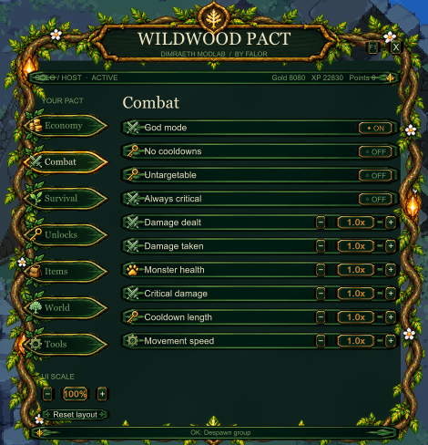
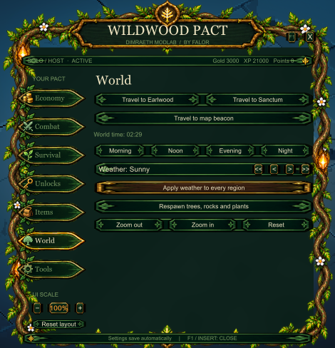
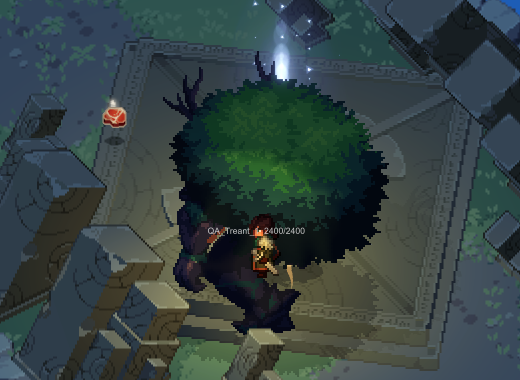

# Wildwood Pact — Dimraeth Mod Menu

An in-game cheat and sandbox menu for **Dimraeth**, built as a BepInEx 6 IL2CPP plugin.
Tested on game build `eDev 0.107.7839`.

<p>
  
  
</p>

Open and close the menu with **Insert** (F1 also works, but the game opens its own Social screen on F1).
Everything works only in single player or when you are the host. In someone else's lobby the menu
shows "PASSIVE" and does nothing.

## Features

| Tab | What it does |
|---|---|
| **Economy** | XP, pet XP, proficiency XP, gold, drop chance and essence multipliers · free shop purchases · free rune / pet / forge upgrades · grant 1,000 XP or gold |
| **Combat** | God mode · no cooldowns · untargetable · always critical · damage dealt / taken, monster health, critical damage, cooldown length and movement speed |
| **Survival** | No hunger or thirst · unlimited tool durability · farm plot limit · game speed · unlimited carry capacity · mature crops · refill vitals · sleep / rest · shield |
| **Unlocks** | All recipes, emotes and codex · deed tiers and deed cooldown reset · add / remove all passives · 1,000 skill points |
| **Items** | Give any item, rune (set + slot, full set) or pet · fill inventory randomly |
| **World** | Travel to Earlwood, Sanctum or your map beacon · time of day · weather · respawn trees, rocks and plants · camera zoom |
| **Tools** | Spawn a monster or a group (optionally passive / damage immune) · despawn them · monster health labels · save and load checkpoints · skip tutorial · activate all quests |



The menu scales with your resolution (UI Scale 80–150 %), remembers its position, and blocks clicks
from reaching the game while the mouse is over it.

## Install

1. Install **BepInEx 6 for Unity IL2CPP, Windows x64, build be.791** into the game folder (next to `Dimraeth.exe`):
   [builds.bepinex.dev](https://builds.bepinex.dev/projects/bepinex_be) →
   `BepInEx-Unity.IL2CPP-win-x64-6.0.0-be.791+b782da4.zip`
2. Start the game once, wait for the main menu, then close it.
3. Download `WildwoodPact-x.y.z.zip` from [Releases](../../releases) and extract it into the game folder.
   The plugin should end up at `Dimraeth\BepInEx\plugins\DimraethModMenu.dll`.
4. Start the game, load a character and press **Insert**.

To uninstall, delete `BepInEx\plugins\DimraethModMenu.dll`.

Settings are stored in `BepInEx\config\falor.dimraeth.modmenu.cfg`; menu size and position in
`BepInEx\config\falor.dimraeth.wildwood-ui.json`.

## Before you use it

- **Make a checkpoint first** (Tools tab) before Skip tutorial, Activate all quests or the skill point button.
  These change your save permanently. Loading a checkpoint returns you to the main menu; press Continue.
- **Grant 1,000 skill points** is marked risky. The game has its own anti-cheat that checks character stats
  and can kick you or block saving.
- Back up `%USERPROFILE%\AppData\LocalLow\Mudtek\Dimraeth` before you start.

## Known limitations

- Some monster types in the spawn list have no model in this game build and cannot be spawned.
- Movement speed is weaker than the number shown (x3 is about x1.7).
- Deed, respawn-resources, farm and tool-durability options run without errors but were not fully verified in game.
- Removed because they break the game: forcing all stats to max (trips the game's anti-cheat) and
  free building (freezes start-up / breaks save loading).

## Building from source

Requirements: .NET 6 SDK or newer, and a game folder where BepInEx has been installed **and run once**
(the build references the generated `BepInEx\interop` assemblies, which are not part of this repository).

```bash
cd src/DimraethModMenu
dotnet build -c Release -p:GameDir="C:/path/to/Dimraeth"
```

You can set the `DIMRAETH_DIR` environment variable instead of passing `-p:GameDir`.
The output is `src/DimraethModMenu/bin/Release/net6.0/DimraethModMenu.dll`; copy it to `BepInEx/plugins`.

Troubleshooting switches: `DIMRAETH_NOMENU=1` starts without the menu, `DIMRAETH_PATCHES=none`
(or a comma-separated list of patch class names) limits which game patches are applied.

### Layout

| File | Purpose |
|---|---|
| `Plugin.cs` | BepInEx entry point, settings, patch loading |
| `Patches.cs` | Harmony patches on the game (multipliers, free shop, carry capacity, …) |
| `ModMenu.cs` | The menu, its tabs and actions (uses the game's own QA tool components) |
| `Wildwood*.cs` | Theme, sprites, labels and saved UI preferences |
| `Assets/` | Menu artwork, embedded into the DLL |

The game's IMGUI build is stripped: only `GUI.Window`, `GUI.Button`, `GUI.Label`, `GUI.DragWindow`,
`GUI.matrix`, `GUI.skin` and scoped color / enabled state are available. `GUILayout`, toggles, sliders
and text fields do not exist at runtime.

## Disclaimer

This is an unofficial fan mod. It is not affiliated with or endorsed by the developers of Dimraeth.
No game files are included in this repository or in the releases. Use at your own risk.

## License

[MIT](LICENSE) © falor. The menu artwork in `src/DimraethModMenu/Assets` was created for this project
with an AI image generator.
